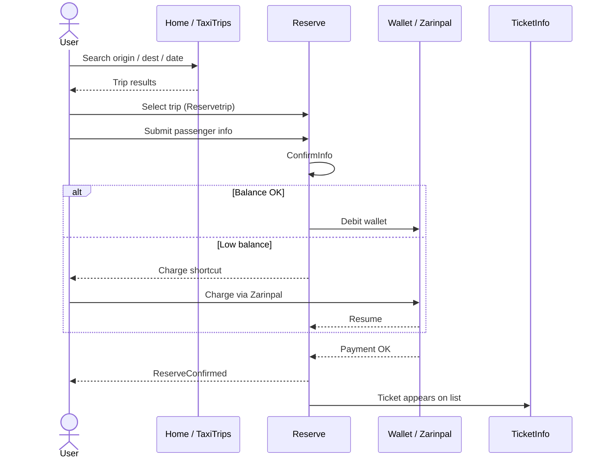
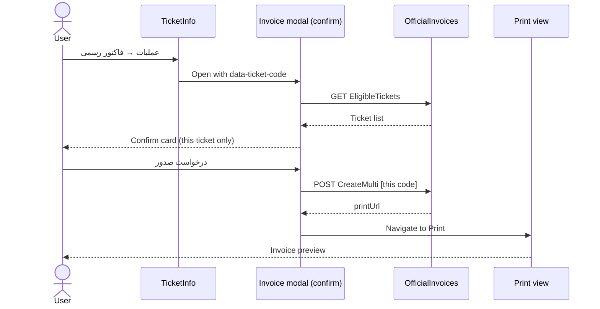
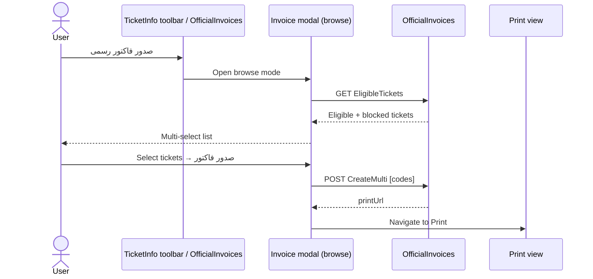
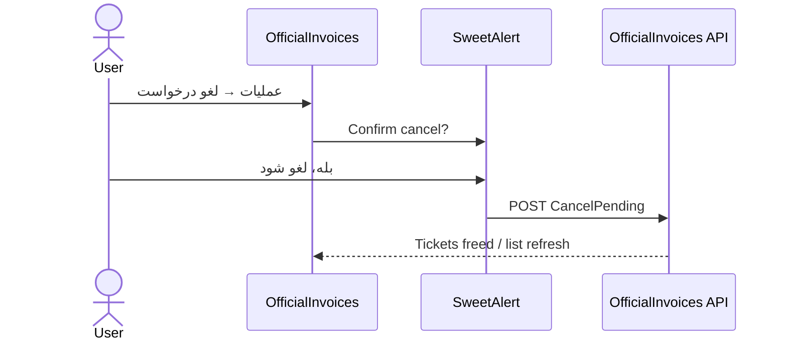
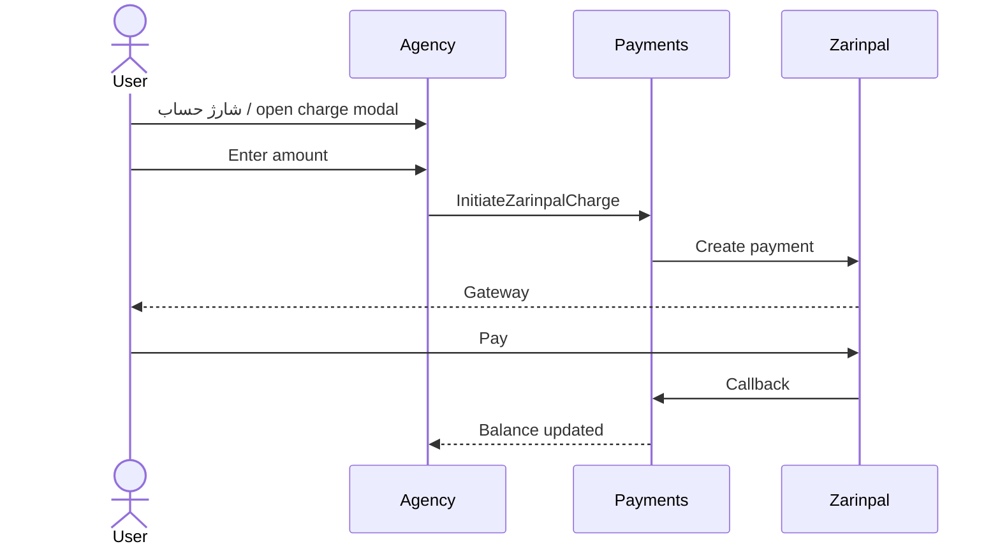

# Agency portal — UML sequence diagrams

Source: [agency-pages-and-journeys.md](../agency-pages-and-journeys.md)

**Rendered view:** open [agency-journeys-sequence.html](./agency-journeys-sequence.html) in a browser.

---

## 1) Book a trip

## 2) Official invoice — row (confirm this ticket)

## 3) Official invoice — browse / multi-select

## 4) Cancel pending invoice

## 5) Charge wallet

