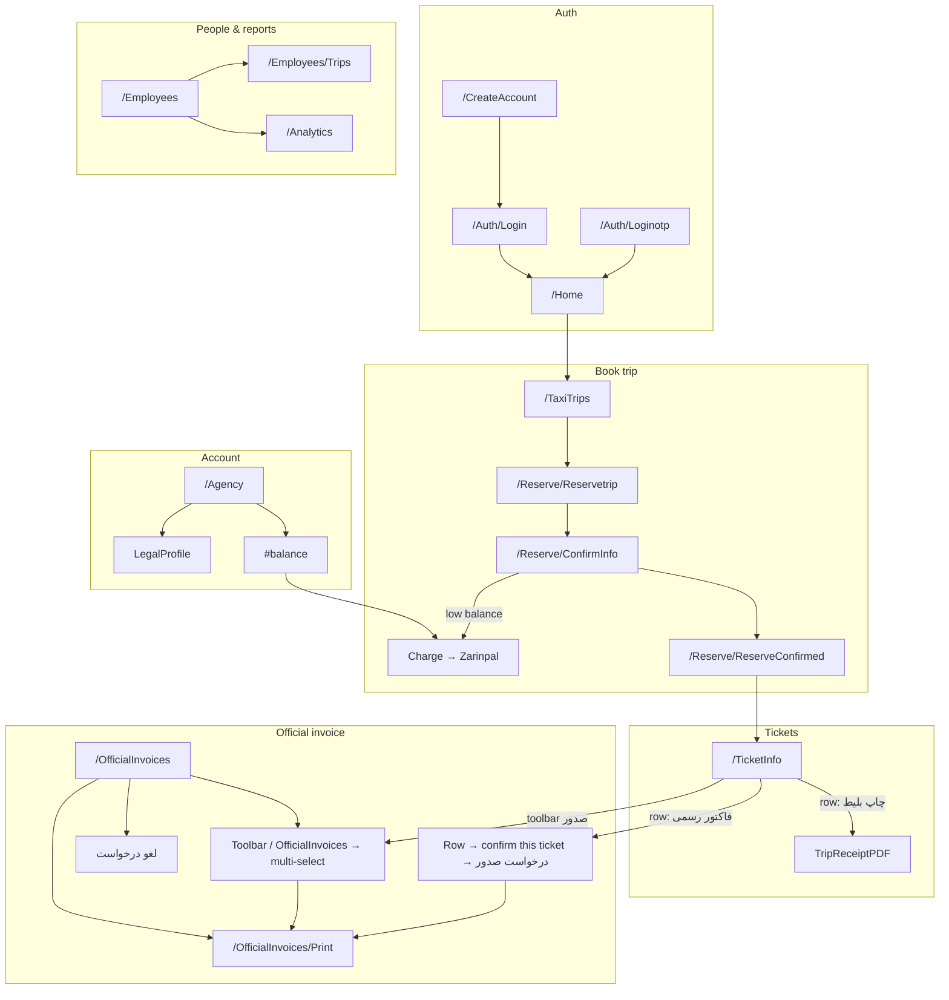
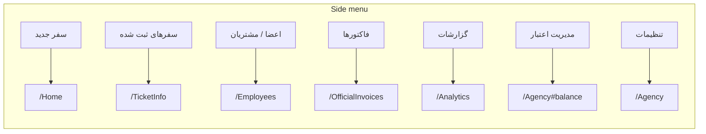

# Agency portal — pages & journeys (visual)

Source: [agency-pages-and-journeys.md](../agency-pages-and-journeys.md)

**To see rendered diagrams:** open [agency-pages-and-journeys.html](./agency-pages-and-journeys.html) in a browser (Cursor Markdown preview shows only the Mermaid text).

## Main journeys

## Side menu → pages

